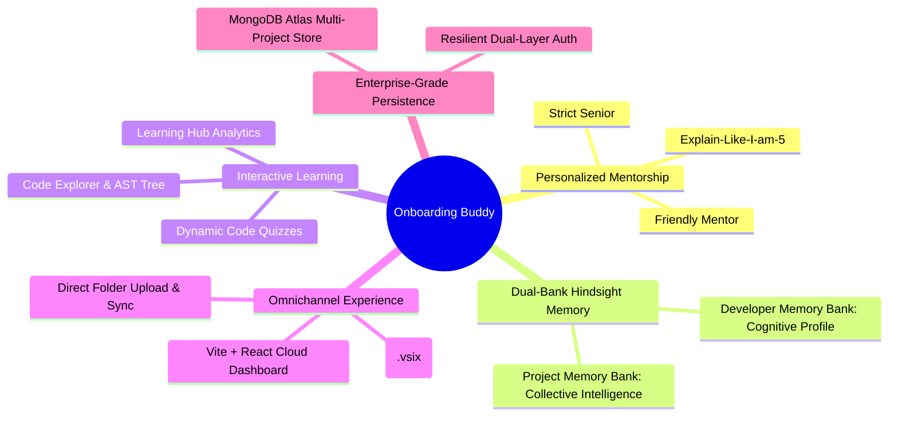
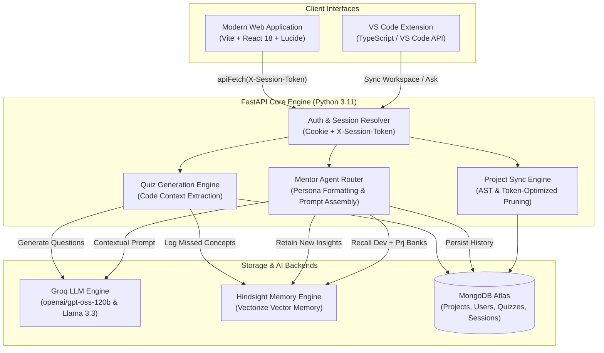
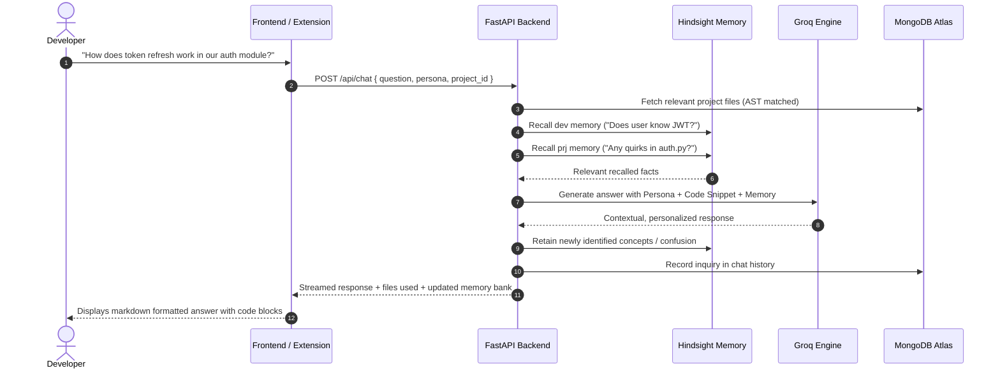

# Onboarding Buddy: The Persistent AI Mentor That Remembers Your Codebase Journey

> **Hackathon Submission Article & Project Story**  
> **Team Name:** UltronX  
> **Team Members:** Soha Iffat, Bharath G, N Chaitanya, Lavanya V, Sammy M, Haider S Vadgamwala  
> **Repository:** [https://github.com/HaiderV/Onboarding-Buddy](https://github.com/HaiderV/Onboarding-Buddy)  

---

## 1. Executive Summary

Every software engineer knows the dreaded "Week One" feeling: you clone a monolithic repository with hundreds of files, open an outdated `README.md`, spend three days wrestling with environment configs, and hesitate to ping senior engineers every twenty minutes. While generative AI tools like ChatGPT and GitHub Copilot can explain isolated code snippets, they suffer from **contextual amnesia**—they don't know what you already know, they forget your previous questions, and they treat senior engineers and junior interns identically.

**Onboarding Buddy** solves this by bridging the gap between raw codebase comprehension and personalized human mentorship. Built by **Team UltronX**, Onboarding Buddy is a dual-interface platform (**VS Code Native Extension** + **Responsive React Web Workspace**) powered by:
- **Groq LLM Acceleration** for sub-second, intelligent mentor reasoning.
- **Hindsight Dual-Bank Memory** for persistent cognitive tracking of personal developer learning alongside collective repository intelligence.
- **MongoDB Atlas** for secure multi-tenant project syncing, session persistence, and assessment analytics.
- **Interactive Code Quizzes & Explorer** that dynamically turn any synced codebase into a customized learning curriculum.

---

## 2. The Problem: The Cost of Developer Ramp-Up

Software onboarding is one of the highest friction points in engineering organizations:

1. **Context Fragmentation:** Architecture decisions are scattered across Slack threads, outdated Notion docs, and oral traditions.
2. **Mentorship Bottlenecks:** Senior engineers spend 20–30% of their sprints answering repetitive setup and architectural questions.
3. **Stateless AI Tools:** Standard coding copilots lack temporal awareness. If you ask *"Why does this middleware use Redis?"* on Monday, and on Wednesday ask *"How does this affect session revocation?"*, standard LLMs treat you like a stranger and repeat basic concepts you already mastered.
4. **Assessment Gap:** There is no lightweight, low-stress mechanism to verify if a new developer actually comprehended the system before submitting their first pull request.

---

## 3. Our Solution: What We Built

**Onboarding Buddy** acts as a senior engineer who sits beside you, watches your progress, and explains code in your preferred tone—without ever losing patience.

### Key Capabilities

### 1. Dual-Interface Access
- **Inside VS Code:** An activity-bar side panel that scans your workspace, selects relevant source files, and syncs your repository state with one click.
- **In the Web Workspace:** A full-screen IDE-grade web application featuring Dark/Light themes, directory trees, file inspection, and quiz generation.

### 2. Dual-Bank Hindsight Memory Architecture
Rather than dumping an entire chat transcript into every LLM prompt (which rapidly crashes token limits), we architected a two-tier cognitive bank:
- **Personal Developer Bank (`dev-<user>`):** Records what concepts the developer has grasped, topics where they struggled, and their preferred pace.
- **Project Intelligence Bank (`prj-<repo>`):** Accumulates collective architectural wisdom, known pitfalls, and design patterns discovered by everyone onboarding to that repository.

### 3. Adaptive Persona Engine
Developers can toggle between:
- **Friendly Mentor:** Encouraging, step-by-step guidance tailored for junior engineers.
- **Strict Senior:** Blunt, production-focused advice prioritizing performance, edge cases, and architectural trade-offs.
- **Explain-Like-I'm-5 (ELI5):** High-level metaphors and simple analogies for rapid conceptual grasp.

### 4. Interactive Code Comprehension Quizzes
The system analyzes synced repository code and dynamically generates multiple-choice questions testing real code logic (e.g. error handling in `auth.py`, caching in `database.py`). Missed topics are automatically fed back into the developer's memory profile to reinforce future explanations.

---

## 4. System Architecture & Data Flow

### End-to-End Request Cycle

---

## 5. Technical Highlights & Engineering Challenges

### Challenge 1: The Token Limit Trap (Groq 8,000 TPM limit)
* **Problem:** In early iterations, syncing large projects and passing entire codebases to Groq resulted in HTTP `413 Request Too Large` (TPM rate limit exceeded).
* **Engineering Solution:** We built a token-efficient chunking and relevance engine:
  1. Files are stripped of binaries, images, and `node_modules` during sync.
  2. File contents are constrained to 4,000 character context windows per source module.
  3. Memory extraction summarizes past conversations into dense 1-sentence facts rather than passing raw dialogue histories.

### Challenge 2: Cross-Origin Authentication Resiliency
* **Problem:** In production, hosting the frontend on Vercel (`*.vercel.app`) and the backend on Render (`*.onrender.com`) introduced cross-site cookie blocking under modern browser privacy controls (SameSite Lax restrictions).
* **Engineering Solution:** We designed a **Dual-Layer Auth Architecture**:
  - The backend dynamically issues `SameSite=None; Secure` cookies when communicating over HTTPS.
  - The backend also yields an encrypted `session_token` parameter upon OAuth redirect.
  - The frontend automatically stores this in `localStorage` and injects an `X-Session-Token` header on every request through a unified `apiFetch` client.

### Challenge 3: Eliminating External Latency Spikes
* **Problem:** Calling GitHub's `/user` endpoint on every API call caused intermittent `httpx.ReadTimeout` errors when GitHub had latency spikes.
* **Engineering Solution:** We instituted an in-memory & database session cache check in `verify_github_user`. Internal requests resolve against MongoDB in `< 5ms`, bypassing external GitHub calls completely.

---

## 6. What We Learned

1. **Memory Beats Context Window Size:** Merely feeding a 128k token context window is neither economically scalable nor cognitively smart. Distilling knowledge into long-term vector-backed memory banks produces answers that feel truly personal and consistent.
2. **Developer Experience Requires Ubiquity:** Developers do not like leaving their editor. Building the VS Code extension alongside the web application ensured that onboarding happens in the developer's natural habitat.
3. **Active Recall Solidifies Knowledge:** Providing interactive quizzes directly on the developer's actual codebase turned passive documentation reading into active learning.

---

## 7. The Team: UltronX

| Member | Role & Key Contributions |
| :--- | :--- |
| **Haider S Vadgamwala** | System Architecture, FastAPI Backend, Groq & Hindsight Integration, Auth Engine |
| **Soha Iffat** | Frontend UI/UX Design, Persona Selector, Accessibility & Light/Dark Theme System |
| **Bharath G** | VS Code Extension Development, Workspace AST Syncing, Extension Host Packaging |
| **N Chaitanya** | MongoDB Atlas Data Modeling, Multi-Project Storage, Database Indexing |
| **Lavanya V** | Interactive Code Quiz Engine, Assessment Scoring, Educational Logic |
| **Sammy M** | DevOps, Render & Vercel Deployment Automation, QA Testing & Documentation |

---

## 8. Conclusion & Future Scope

Onboarding Buddy transforms codebase onboarding from a painful week of isolation into an engaging, interactive conversation. By combining sub-second Groq inference with persistent Hindsight memory, we've built a system that doesn't just explain code—it grows alongside the developer.

**Next steps for Onboarding Buddy:**
- Automated Pull Request Mentorship (analyzing PRs and mentoring contributors before merge).
- Interactive In-Browser Code Sandboxes for quiz challenges.
- Team-wide knowledge graph heatmaps for engineering leaders.

